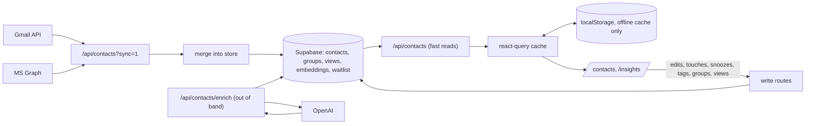

# Architecture

Node (repo `node-exploration`) is a professional-network CRM: sign in with Google or Microsoft, build a contact list from the metadata of your sent email, enrich it with AI, organize it with tags, groups and saved views, and let a reconnect queue tell you who is going cold.

## Stack

| Layer | Choice |
|---|---|
| Framework | Next.js 15 (app router), React 18, TypeScript strict |
| Auth | NextAuth v4, JWT sessions, Google + Microsoft Entra OAuth |
| Database | Supabase Postgres, accessed only server-side via the service-role key |
| AI | OpenAI: chat completions for company enrichment, text-embedding-3-small for semantic search |
| Styling | Tailwind + a small shadcn/ui set; landing page has its own dark constellation theme |
| Analytics | PostHog, autocapture disabled |

## System shape

## Core principles

1. **The server store is the source of truth.** `localStorage` is an offline and fast-boot cache, never the system of record. Every cache writer goes through `persistContacts()` so the persisted shape (`{ contacts, lastUpdated, userEmail }`) stays uniform.
2. **Provider syncs merge, never replace.** A mailbox pull wins on recency (interactions, last-contacted); the store wins on intent (edits, enrichment, tags, notes, spam flags). Contacts that fall outside the last ~100 sent emails survive forever.
3. **Graceful degradation at every seam.** Missing table: the store helpers report `available: false` and routes fall back to stateless behavior. Missing column (a migration not yet applied): writes strip the new columns and retry (`NEW_COLUMNS` in `contactsStore`). The app never breaks because the database is a migration behind.
4. **Expensive work stays off the request path.** AI enrichment and embedding sync run out of band, triggered by the client after data renders. Mailbox reads are concurrency-capped. Every OpenAI-backed route is rate-limited per user.
5. **Secrets stay server-side.** The OAuth access token lives only in the httpOnly JWT (`getToken()`), never on the client-visible session. The Supabase service-role key exists only in server routes. RLS is enabled with zero policies on every table, so browser keys read nothing.

## Data model (Supabase)

All tables: RLS on, no policies, service-role access only. Keyed by `owner_email` (the signed-in user) so one database serves all users with no cross-tenant reads.

| Table | Key | Holds |
|---|---|---|
| `contacts` | `(owner_email, email)` | name, company, industry, `last_contacted`, `interactions` jsonb (dated, with channel, subject, snippet), `custom_fields`, `tags`, `notes`, `is_spam`, `met_at`, `snoozed_until`, `introduced_by`, source |
| `groups` | `(owner_email, id)` | name, `members` jsonb (email list); client-generated ids |
| `views` | `(owner_email, id)` | name, `config` jsonb (search, filter, sort) |
| `contact_embeddings` / `interaction_embeddings` | owner + content hash | pgvector embeddings for semantic search; hash-gated so unchanged content is never re-embedded |
| `waitlist` | email | landing-page signups; the only table with a policy (anon insert) |

Migrations live in `supabase/migrations/` and are applied via the Supabase SQL editor or `supabase db push`. They are idempotent (`if not exists` throughout).

## API surface

| Route | Verb | Purpose | Guard |
|---|---|---|---|
| `/api/contacts` | GET | stored contacts; `?sync=1` pulls the mailbox and merges | JWT token; sync 10/min |
| `/api/contacts` | POST | quick-add one contact (met-at, tags, intro, note) | session |
| `/api/contacts/[email]` | PUT | update, addressed by original email so email edits do not fork | session |
| `/api/contacts/import` | POST | CSV import, validated, capped at 2000 rows | session; 4/min |
| `/api/contacts/enrich` | POST | enrich stored contacts missing a company, persist | session; 4/min |
| `/api/contacts/touch` | POST | log an email, call, meeting or other outreach; bumps recency | session |
| `/api/contacts/reconnect` | POST | snooze a contact out of the queue for N days | session |
| `/api/contacts/tags` | POST | add one tag to up to 500 contacts | session |
| `/api/contacts/spam` | POST | persist cleanup-assistant decisions | session |
| `/api/groups`, `/api/views` | GET, PUT | list and replace-set, client-generated ids | session; PUT 30/min |
| `/api/embeddings/sync`, `/api/search`, `/api/contacts/similar` | POST, GET, GET | semantic layer | session; 6/min and 30/min |
| `/api/contacts/zapier` | POST | export to a Zapier webhook, host-allowlisted | session |

Error responses are generic; details stay in server logs.

## Frontend structure

- `src/app/contacts/page.tsx`: the core surface. `useContacts()` (single query key, network-first), the Going-cold `ReconnectRail`, filter chips (quick filters, groups, tags, saved views), the spreadsheet `ContactTable` with selection and bulk tagging, quick-add, import, export, cleanup assistant.
- `src/app/insights/page.tsx`: compact rail, `NetworkScore` (priority-aware, computed), `SmartInsights` groupings, activity timeline. Everything memoized; widgets wrapped in error boundaries.
- `src/hooks/useContacts.ts`: the one contacts query plus `persistContacts` and `syncContacts`. All cache writers produce the same shape.
- `src/utils/reconnect.ts`: the going-cold queue (45-day threshold, spam and no-reply excluded, snoozes respected, priority contacts first). Priority means tagged `key-contact` or in a group (`isPriorityContact`); other tags do not reorder the queue. A contact with no recorded touch ages from `createdAt` instead of being skipped.
- `src/utils/networkAnalytics.ts`: the score. With 3+ priority contacts (key-contact or grouped) it measures that subset.
- `src/lib/`: `contactsStore`, `groupsStore`, `viewsStore` (service-role repositories), `email-contacts` (shared mail aggregation core for the Gmail and Graph clients), `enrich*`, `rateLimit`, `clientSignOut`.

## Auth flow

NextAuth JWT sessions (30 days). On sign-in the provider tokens land in the JWT; access tokens are refreshed via the stored refresh token about a minute before expiry, and a failed refresh surfaces as `session.error` plus a 401 so the client can re-authenticate. A dev-only demo credentials provider exists behind `ALLOW_DEMO_LOGIN` and a production guard; it is currently disabled.

## Engineering gates

CI on every PR and push to main: `npm run typecheck`, `next lint` capped at 20 warnings, `npm run knip` (zero unused files), production build. Conventions: no em dashes anywhere, user-facing copy claims only what shipped, every write path degrades gracefully, and scripts in `scripts/` are entry points (`knip.json`).
