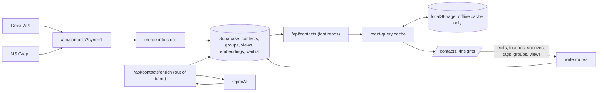

# Architecture

Node (repo `node-exploration`) is a professional-network CRM: sign in with Google or Microsoft, build a contact list from the metadata of your sent email, enrich it with AI, organize it with tags, groups and saved views, and let a reconnect queue tell you who is going cold.

## Stack

| Layer | Choice |
|---|---|
| Framework | Next.js 15 (app router), React 18, TypeScript strict |
| Auth | NextAuth v4, JWT sessions, Google + Microsoft Entra OAuth |
| Database | Supabase Postgres, accessed only server-side via the service-role key |
| AI | OpenAI: chat completions for company enrichment, text-embedding-3-small for semantic search |
| Styling | Tailwind + a small shadcn/ui set; landing page has its own dark constellation theme |
| Analytics | PostHog, autocapture disabled |

## System shape

## Core principles

1. **The server store is the source of truth.** `localStorage` is an offline and fast-boot cache, never the system of record. Every cache writer goes through `persistContacts()` so the persisted shape (`{ contacts, lastUpdated, userEmail }`) stays uniform.
2. **Provider syncs merge, never replace.** A mailbox pull adds to the stored history and the newest touch wins on recency, whichever side recorded it, so logged calls and emails that have left the provider's window survive a sync; the store wins on intent (edits, enrichment, tags, notes, spam flags). Contacts that fall outside the last ~100 sent emails survive forever.
3. **Graceful degradation at every seam.** Missing table: the store helpers report `available: false` and routes fall back to stateless behavior. Missing column (a migration not yet applied): writes strip the new columns and retry (`NEW_COLUMNS` in `contactsStore`). The app never breaks because the database is a migration behind.
4. **Expensive work stays off the request path.** AI enrichment and embedding sync run out of band, triggered by the client after data renders. Memory (summary and open loops) is read only for the contacts the user is looking at, the rail's five and an open contact detail, and each contact's history is hashed so an unchanged one is never re-read. Mailbox reads are concurrency-capped. Every OpenAI-backed route is rate-limited per user.
5. **Secrets stay server-side.** The OAuth access token lives only in the httpOnly JWT (`getToken()`), never on the client-visible session. The Supabase service-role key exists only in server routes. RLS is enabled with zero policies on every table, so browser keys read nothing.

## Data model (Supabase)

All tables: RLS on, no policies, service-role access only. Keyed by `owner_email` (the signed-in user) so one database serves all users with no cross-tenant reads.

| Table | Key | Holds |
|---|---|---|
| `contacts` | `(owner_email, email)` | name, company, industry, `last_contacted`, `interactions` jsonb (dated, with channel, subject, snippet), `custom_fields`, `tags`, `notes`, `is_spam`, `met_at`, `snoozed_until`, `introduced_by`, `intended_layer` (where the user wants them on the orbit map, 1 to 4), `memory` jsonb (summary and open loops the model read from the mail, with the source hash), source |
| `groups` | `(owner_email, id)` | name, `members` jsonb (email list); client-generated ids |
| `views` | `(owner_email, id)` | name, `config` jsonb (search, filter, sort) |
| `contact_embeddings` / `interaction_embeddings` | owner + content hash | pgvector embeddings for semantic search; hash-gated so unchanged content is never re-embedded |
| `waitlist` | email | landing-page signups; the only table with a policy (anon insert) |
| `digest_subscribers` | `owner_email` | who opted in to the Monday digest, and when it was last sent |

Migrations live in `supabase/migrations/` and are applied via the Supabase SQL editor or `supabase db push`. They are idempotent (`if not exists` throughout).

## API surface

| Route | Verb | Purpose | Guard |
|---|---|---|---|
| `/api/contacts` | GET | stored contacts; `?sync=1` pulls the mailbox and merges | JWT token; sync 10/min |
| `/api/contacts` | POST | quick-add one contact (met-at, tags, intro, note) | session |
| `/api/contacts/[email]` | PUT | update, addressed by original email so email edits do not fork | session |
| `/api/contacts/import` | POST | CSV import, validated, capped at 2000 rows | session; 4/min |
| `/api/contacts/enrich` | POST | enrich stored contacts missing a company, persist | session; 4/min |
| `/api/contacts/touch` | POST | log an email, call, meeting or other outreach; bumps recency | session |
| `/api/contacts/reconnect` | POST | snooze a contact out of the queue for N days | session |
| `/api/contacts/orbit` | POST | set or clear where a contact should sit on the orbit map (1 to 4) | session; 60/min |
| `/api/contacts/memory` | POST | read, or re-read with `force`, the memory of up to eight contacts the user is looking at; unchanged history costs no model call | session; 6/min |
| `/api/contacts/draft` | POST | a two-to-four sentence reconnect email for one contact, written by the model or assembled from the same facts | session; 20/min |
| `/api/contacts/intros` | POST | the introductions worth making, from stored embeddings: alike profiles, never on an email together, both in touch | session; 4/min |
| `/api/digest` | GET, PUT | the caller's digest as it would be sent today (`?format=html` renders it); opt in or out | session; GET 20/min |
| `/api/digest/send` | POST | mail the digest to everyone who opted in; skips people with nobody going cold | `CRON_SECRET` bearer token |
| `/api/contacts/tags` | POST | add one tag to up to 500 contacts | session |
| `/api/contacts/spam` | POST | persist cleanup-assistant decisions | session |
| `/api/groups`, `/api/views` | GET, PUT | list and replace-set, client-generated ids | session; PUT 30/min |
| `/api/embeddings/sync`, `/api/search`, `/api/contacts/similar` | POST, GET, GET | semantic layer | session; 6/min and 30/min |
| `/api/contacts/zapier` | POST | export to a Zapier webhook, host-allowlisted | session |

Error responses are generic; details stay in server logs.

## Frontend structure

- `src/app/contacts/page.tsx`: the core surface. `useContacts()` (single query key, network-first), the Going-cold `ReconnectRail`, filter chips (quick filters, groups, tags, saved views), the spreadsheet `ContactTable` with selection and bulk tagging, quick-add, import, export, cleanup assistant.
- `src/app/orbit/page.tsx`, `src/utils/orbit.ts`, `src/components/OrbitMap.tsx`: the orbit map. Every real contact is a point around the user; closeness (recency with a 90-day half-life, frequency over the last year, depth of history, a nudge for priority) ranks them into rings of 5, 15, 50 and 150 with a faint band beyond, colleagues share a wedge, and going-cold contacts are coloured from the cadence assessment. Dragging a dot to a ring stores `intended_layer`; a hollow marker shows it when it differs from the ring activity puts them in, and the inner two rings count as priority in the queue. A slider replays up to a year of drift: `contactsAsOf` projects the contacts back to a moment and the same layout runs with that moment as now.
- `src/lib/memory.ts` and the memory route: memory that writes itself. The subjects and short previews already stored for a contact (newest 20) go to the model with a fixed JSON shape; back come a two-sentence summary and up to four open loops (who promised what, on which date). Everything the model reads is third-party text and is treated as data: strings are clipped, every loop date must be one of the source dates, and the result lives on the owner's row only. The reconnect rail shows the newest open loop ("You promised: send the deck"); `ContactDetail` shows the whole memory with a re-read button.
- `src/lib/draft.ts` and `src/utils/compose.ts`: the one-tap reconnect draft. The facts on record (name, company, where you met, who introduced, recent subject lines, notes, the memory summary and open loops, the silence against the pair's usual gap) go to the model with a fixed JSON shape; back comes a short opener that names one real thing and ends with one easy ask. Without a model the same facts are assembled into a plain draft. The rail card turns into an editor with "Open in Gmail" (or Outlook, or the mail app, by provider) and "Sent it", which logs the touch.
- `src/utils/intros.ts`, the intros route and `IntroSuggestions`: intros worth making. The 30 most recently contacted people each bring their five nearest neighbours by profile embedding (`similar_contacts`, in Postgres, no model call); a pair is kept when both are people the user has written to in the last 180 days, they are not colleagues (same company or work domain), have never been on an email together, and neither introduced the other. Score is similarity times the geometric mean of the two closeness scores. The insights page shows three with a one-line reason and a ready-to-edit double opt-in note to either side; dismissals live in localStorage per user.
- `src/lib/digest.ts`, `digestStore.ts`, the digest routes and `DigestSettings`: the Monday digest. Built from the same `computeReconnectQueue` the rail shows (the going-cold five, their rhythm line, the last subject, the newest open loop, a mailto link), as text and inline-styled HTML with every header-derived string escaped. Opt-in only: a toggle on the insights page writes `digest_subscribers`; `vercel.json` schedules `/api/digest/send` for Monday 13:00 UTC and Vercel attaches the `CRON_SECRET` bearer token; the route sends through Resend's REST API (`RESEND_API_KEY`, `DIGEST_FROM`) and marks `last_sent_at`. Any other scheduler can call the route the same way.
- `src/utils/rehearsal.ts` and `RehearsalCard`: name rehearsal, Anki for people. Anyone with a met-at or a `remember` tag is in rotation; a card shows the captured context first (where you met, company, who introduced, your note) and the name second; Got it pushes the card out on an expanding schedule (1, 3, 7, 14, 30, 60 days), Missed brings it back tomorrow. The schedule lives in localStorage per user and is purged on sign-out.
- `src/app/insights/page.tsx`: compact rail, `NetworkScore` (priority-aware, computed), `SmartInsights` groupings, activity timeline. Everything memoized; widgets wrapped in error boundaries.
- `src/hooks/useContacts.ts`: the one contacts query plus `persistContacts` and `syncContacts`. All cache writers produce the same shape.
- `src/utils/reconnect.ts` and `src/utils/cadence.ts`: the going-cold queue, judged per relationship. A pair with three or more past gaps between touches is measured against its own rhythm (a log-normal over those gaps); with less history it is measured against the user's typical gap, floored at 45 days. A contact enters the queue when the silence is more likely than not to be past that typical gap, and never under two weeks of silence. Spam and no-reply excluded, snoozes respected, priority contacts first, then the most overdue. Priority means tagged `key-contact` or in a group (`isPriorityContact`); other tags do not reorder the queue. A contact with no recorded touch ages from `createdAt` instead of being skipped.
- `src/utils/networkAnalytics.ts`: the score. With 3+ priority contacts (key-contact or grouped) it measures that subset.
- `src/lib/`: `contactsStore`, `groupsStore`, `viewsStore` (service-role repositories), `email-contacts` (shared mail aggregation core for the Gmail and Graph clients), `enrich*`, `rateLimit`, `clientSignOut`.

## Auth flow

NextAuth JWT sessions (30 days). On sign-in the provider tokens land in the JWT; access tokens are refreshed via the stored refresh token about a minute before expiry, and a failed refresh surfaces as `session.error` plus a 401 so the client can re-authenticate. A dev-only demo credentials provider exists behind `ALLOW_DEMO_LOGIN` and a production guard; it is currently disabled.

## Engineering gates

CI on every PR and push to main: `npm run typecheck`, `next lint` capped at 20 warnings, `npm run knip` (zero unused files), production build. Conventions: no em dashes anywhere, user-facing copy claims only what shipped, every write path degrades gracefully, and scripts in `scripts/` are entry points (`knip.json`).
